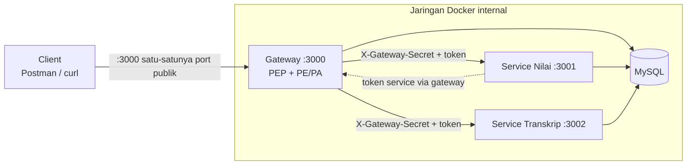
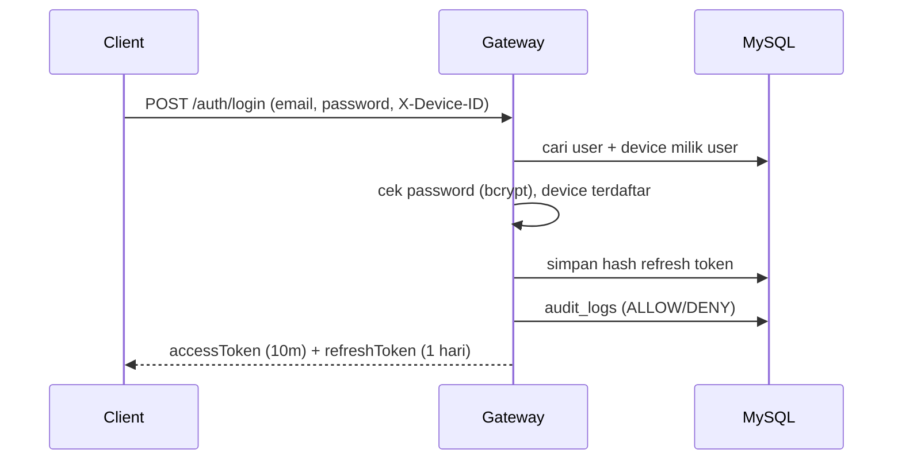
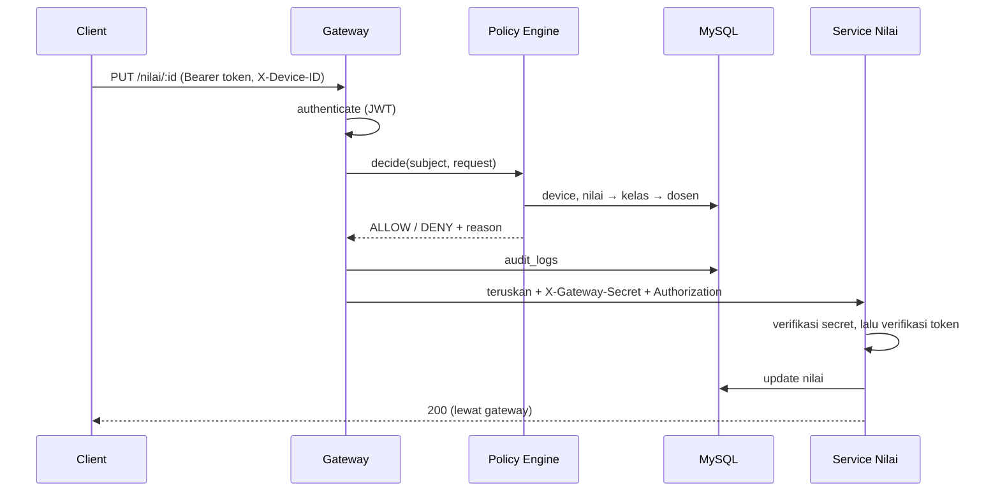
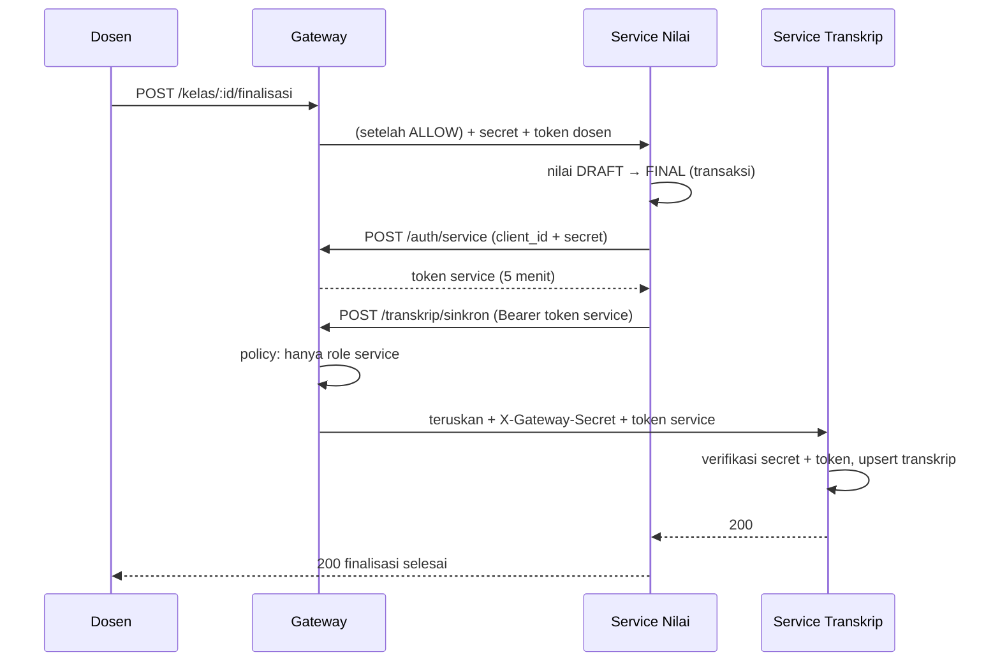

# ARCHITECTURE

Mengikuti Gambar 1 pada soal. Lihat juga [POLICY.md](./POLICY.md) dan [DATABASE.md](./DATABASE.md).

## 1. Peta komponen (NIST SP 800-207)

| Komponen | Peran NIST | Lokasi | Tanggung jawab |
|---|---|---|---|
| API Gateway | PEP | `gateway/src/middlewares`, `proxy`, `routes/guarded.routes.js` | Satu-satunya pintu masuk: autentikasi token, minta keputusan, catat audit, teruskan |
| Policy Engine | PE | `gateway/src/policy/` | Fungsi `decide()` → `ALLOW`/`DENY` + alasan |
| Policy Administrator | PA | `gateway/src/services/auth.service.js`, `token.service.js` | Login, terbitkan/cabut token |
| Service Nilai | Resource | `service-nilai/` | Data nilai & kelas |
| Service Transkrip | Resource | `service-transkrip/` | Data transkrip |
| Database | Resource | MySQL + Prisma | Data & atribut yang dibaca Policy Engine |
| Audit Log | Data source | tabel `audit_logs` | Ditulis gateway |

PE/PA adalah **modul di dalam gateway** (sesuai Tabel 2), tetapi dipisahkan di folder `policy/` dan `services/` agar jelas batasnya.

## 2. Zona kepercayaan & jaringan Docker



- Compose memakai dua network: `public` (hanya gateway) dan `internal` (semua).
- Service Nilai & Transkrip **tidak** memakai `ports:`. Hanya `expose:`.
- MySQL dipublikasikan ke `127.0.0.1:3307` untuk keperluan dev (Prisma Studio).
- phpMyAdmin di `127.0.0.1:8081` untuk melihat tabel lewat browser (dev saja, termasuk `audit_logs`). Keduanya diikat ke localhost sehingga tidak terjangkau dari jaringan luar; service aplikasi tetap tanpa `ports:`.
- Untuk demo "akses langsung ditolak", pakai `docker-compose.demo.yml` yang menerbitkan 3001/3002.

## 3. Pipeline request di gateway

Setiap route terproteksi melewati urutan yang sama (didefinisikan di `routes/guarded.routes.js`):

```
request-id → authenticate → enforce-policy → service-proxy
```

| Langkah | Berkas | Yang dilakukan | Jika gagal |
|---|---|---|---|
| 1 | `request-id.middleware.js` | Buat `X-Request-ID` | — |
| 2 | `authenticate.middleware.js` | Verifikasi JWT (tanda tangan, exp, tipe) → `req.subject` | 401 + audit DENY |
| 3 | `enforce-policy.middleware.js` | Panggil `policy.engine.decide()`, tulis audit | 403 + audit DENY |
| 4 | `proxy/service-proxy.js` | Buang `X-Gateway-Secret` dari klien, set secret milik gateway, teruskan | 502 jika service mati |

Di dalam `decide()`:
1. Cek tipe subjek yang diizinkan rule (USER / SERVICE)
2. Jika USER → `device.check` (X-Device-ID terdaftar untuk user)
3. Jalankan rule endpoint (role, kepemilikan, status, jam akses)

Route yang tidak cocok dengan daftar → `not-found.middleware.js` → DENY `ROUTE_NOT_ALLOWED` + audit.

Catatan: `express.json()` **hanya** dipasang di `/auth/*`. Jika dipasang global, body request habis dibaca dan proxy menggantung.

## 4. Alur utama

### 4.1 Login



### 4.2 Request terproteksi (contoh PUT /nilai/:id)



### 4.3 Finalisasi kelas → sinkron transkrip



Jika sinkron gagal: nilai tetap FINAL, `kelas.transkrip_synced_at` tetap kosong, respons 502. Memanggil finalisasi lagi hanya mengulang sinkron (idempotent, `upsert`). Jika sudah final **dan** tersinkron → 409.

## 5. Pemisahan tanggung jawab (berlaku di ketiga aplikasi)

```
Request → routes → middleware → controller → service → repository → Prisma → MySQL
```

| Lapisan | Boleh | Tidak boleh |
|---|---|---|
| `routes/` | Memetakan URL + method ke middleware dan controller | Logika apa pun |
| `middlewares/` | Autentikasi, validasi, policy, error handling | Query database langsung (pakai repository) |
| `controllers/` | Ambil data dari `req`, panggil service, kirim `res` | Aturan bisnis, Prisma |
| `services/` | Aturan bisnis, orkestrasi, transaksi | Menyentuh `req`/`res` |
| `repositories/` | Satu-satunya tempat memakai Prisma | Aturan bisnis |
| `validators/` | Skema zod | — |
| `lib/` | Util kecil: prisma client, error, response | — |

Detail dan contoh kode: [CONVENTIONS.md](./CONVENTIONS.md).

## 6. Struktur folder

```
sistem-nilai-zero-trust/
├─ AGENTS.md
├─ README.md
├─ docker-compose.yml
├─ docker-compose.demo.yml        # menerbitkan 3001/3002 khusus demo
├─ .env.example
├─ .dockerignore
├─ docs/                          # semua dokumen perencanaan ini
├─ scripts/
│  ├─ smoke-test.sh               # menjalankan skenario TESTING.md
│  └─ show-audit.sh               # tampilkan audit log di terminal
├─ database/
│  ├─ Dockerfile                  # container db-init (migrate + seed)
│  ├─ package.json
│  └─ prisma/
│     ├─ schema.prisma            # SATU-SATUNYA sumber schema
│     ├─ migrations/
│     └─ seed.js
├─ gateway/
│  ├─ Dockerfile
│  ├─ package.json
│  └─ src/
│     ├─ server.js                # listen port
│     ├─ app.js                   # rakit middleware + routes
│     ├─ config/env.js
│     ├─ routes/
│     │  ├─ index.js
│     │  ├─ auth.routes.js        # /auth/* (ditangani gateway)
│     │  └─ guarded.routes.js     # /nilai /kelas /transkrip (diteruskan)
│     ├─ controllers/auth.controller.js
│     ├─ services/
│     │  ├─ auth.service.js
│     │  ├─ token.service.js
│     │  └─ audit.service.js
│     ├─ repositories/
│     │  ├─ user.repository.js
│     │  ├─ device.repository.js
│     │  ├─ refresh-token.repository.js
│     │  ├─ service-client.repository.js
│     │  ├─ audit-log.repository.js
│     │  ├─ kelas.repository.js
│     │  └─ nilai.repository.js
│     ├─ policy/
│     │  ├─ policy.engine.js
│     │  ├─ reasons.js            # daftar kode alasan
│     │  ├─ checks/
│     │  │  ├─ device.check.js
│     │  │  └─ access-hours.check.js
│     │  └─ rules/
│     │     ├─ nilai.rules.js
│     │     ├─ kelas.rules.js
│     │     └─ transkrip.rules.js
│     ├─ middlewares/
│     │  ├─ request-id.middleware.js
│     │  ├─ authenticate.middleware.js
│     │  ├─ enforce-policy.middleware.js
│     │  ├─ validate.middleware.js
│     │  ├─ not-found.middleware.js
│     │  └─ error-handler.middleware.js
│     ├─ proxy/service-proxy.js
│     ├─ validators/auth.validator.js
│     ├─ lib/ (prisma.js, errors.js, hash.js, response.js)
│     └─ docs/openapi.yaml
├─ service-nilai/
│  ├─ Dockerfile, package.json
│  └─ src/
│     ├─ server.js, app.js, config/env.js
│     ├─ routes/ (nilai.routes.js, kelas.routes.js)
│     ├─ controllers/ (nilai.controller.js, kelas.controller.js)
│     ├─ services/ (nilai.service.js, kelas.service.js, gateway-client.service.js)
│     ├─ repositories/ (nilai.repository.js, kelas.repository.js)
│     ├─ middlewares/ (verify-gateway-secret, verify-token, require-role, error-handler)
│     ├─ validators/, lib/
└─ service-transkrip/
   ├─ Dockerfile, package.json
   └─ src/
      ├─ server.js, app.js, config/env.js
      ├─ routes/transkrip.routes.js
      ├─ controllers/transkrip.controller.js
      ├─ services/transkrip.service.js
      ├─ repositories/ (transkrip.repository.js, user.repository.js)
      ├─ middlewares/ (verify-gateway-secret, verify-token, require-role, error-handler)
      ├─ validators/, lib/ (prisma, errors, response, grade.js)
```

`gateway/prisma/` dan `service-*/prisma/` tidak ada di repo: Dockerfile menyalin `database/prisma/schema.prisma` saat build lalu menjalankan `prisma generate`.

## 7. Docker Compose

| Service | Image/Build | Port host | Depends on | Catatan |
|---|---|---|---|---|
| `mysql` | `mysql:8.4` | `127.0.0.1:3307` | — | healthcheck `mysqladmin ping`, volume data |
| `phpmyadmin` | `phpmyadmin:5` | `127.0.0.1:8081` | mysql (healthy) | alat lihat tabel saat dev; tidak dipakai aplikasi |
| `db-init` | `database/Dockerfile` | — | mysql (healthy) | `migrate deploy` + seed, lalu berhenti |
| `gateway` | `gateway/Dockerfile` | `3000` | db-init (completed) | satu-satunya port publik |
| `service-nilai` | `service-nilai/Dockerfile` | — | db-init (completed) | `expose: 3001` |
| `service-transkrip` | `service-transkrip/Dockerfile` | — | db-init (completed) | `expose: 3002` |

Build context = root repo (agar `database/prisma/schema.prisma` terbaca). Variabel env: lihat `.env.example` di [AGENTS.md](../AGENTS.md#env).
