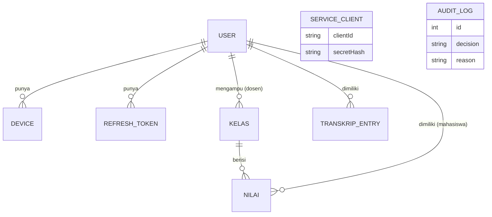

# DATABASE

MySQL 8.4 + Prisma 6. Satu database bersama. Satu-satunya sumber schema: `database/prisma/schema.prisma`.

## 1. ERD



`SERVICE_CLIENT` dan `AUDIT_LOG` berdiri sendiri (audit tidak diberi foreign key agar subjek anonim/tidak dikenal tetap bisa dicatat).

## 2. Schema Prisma

```prisma
generator client {
  provider      = "prisma-client-js"
  binaryTargets = ["native"]
}

datasource db {
  provider = "mysql"
  url      = env("DATABASE_URL")
}

enum Role {
  MAHASISWA
  DOSEN
  ADMIN
}

enum NilaiStatus {
  DRAFT
  FINAL
}

enum SubjectType {
  USER
  SERVICE
  ANONYMOUS
}

enum AuditDecision {
  ALLOW
  DENY
}

model User {
  id           String   @id @default(uuid()) @db.VarChar(36)
  name         String   @db.VarChar(100)
  email        String   @unique @db.VarChar(120)
  passwordHash String   @map("password_hash") @db.VarChar(100)
  role         Role
  nim          String?  @unique @db.VarChar(20) // hanya mahasiswa
  nidn         String?  @unique @db.VarChar(20) // hanya dosen
  isActive     Boolean  @default(true) @map("is_active")
  createdAt    DateTime @default(now()) @map("created_at")

  devices       Device[]
  refreshTokens RefreshToken[]
  kelasDiampu   Kelas[]          @relation("DosenKelas")
  nilai         Nilai[]
  transkrip     TranskripEntry[]

  @@map("users")
}

model Device {
  id        String   @id @default(uuid()) @db.VarChar(36)
  userId    String   @map("user_id") @db.VarChar(36)
  deviceId  String   @map("device_id") @db.VarChar(100)
  label     String?  @db.VarChar(100)
  createdAt DateTime @default(now()) @map("created_at")

  user User @relation(fields: [userId], references: [id], onDelete: Cascade)

  @@unique([userId, deviceId])
  @@map("devices")
}

model RefreshToken {
  id        String    @id @default(uuid()) @db.VarChar(36)
  userId    String    @map("user_id") @db.VarChar(36)
  tokenHash String    @unique @map("token_hash") @db.VarChar(64) // SHA-256 hex
  deviceId  String    @map("device_id") @db.VarChar(100)
  expiresAt DateTime  @map("expires_at")
  revokedAt DateTime? @map("revoked_at")
  createdAt DateTime  @default(now()) @map("created_at")

  user User @relation(fields: [userId], references: [id], onDelete: Cascade)

  @@index([userId])
  @@map("refresh_tokens")
}

model ServiceClient {
  id         String  @id @default(uuid()) @db.VarChar(36)
  clientId   String  @unique @map("client_id") @db.VarChar(60)
  secretHash String  @map("secret_hash") @db.VarChar(100)
  name       String  @db.VarChar(100)
  isActive   Boolean @default(true) @map("is_active")

  @@map("service_clients")
}

model Kelas {
  id                String    @id @default(uuid()) @db.VarChar(36)
  kode              String    @unique @db.VarChar(20) // cth. IF301-A
  kodeMk            String    @map("kode_mk") @db.VarChar(20)
  mataKuliah        String    @map("mata_kuliah") @db.VarChar(100)
  sks               Int
  semester          String    @db.VarChar(20) // cth. 2026/Ganjil
  dosenId           String    @map("dosen_id") @db.VarChar(36)
  finalizedAt       DateTime? @map("finalized_at")
  transkripSyncedAt DateTime? @map("transkrip_synced_at")

  dosen User    @relation("DosenKelas", fields: [dosenId], references: [id])
  nilai Nilai[]

  @@index([dosenId])
  @@map("kelas")
}

model Nilai {
  id          String      @id @default(uuid()) @db.VarChar(36)
  kelasId     String      @map("kelas_id") @db.VarChar(36)
  mahasiswaId String      @map("mahasiswa_id") @db.VarChar(36)
  score       Float?      // 0-100, kosong = belum diisi
  status      NilaiStatus @default(DRAFT)
  finalizedAt DateTime?   @map("finalized_at")
  updatedAt   DateTime    @updatedAt @map("updated_at")

  kelas     Kelas @relation(fields: [kelasId], references: [id], onDelete: Cascade)
  mahasiswa User  @relation(fields: [mahasiswaId], references: [id], onDelete: Cascade)

  @@unique([kelasId, mahasiswaId])
  @@map("nilai")
}

model TranskripEntry {
  id          String   @id @default(uuid()) @db.VarChar(36)
  mahasiswaId String   @map("mahasiswa_id") @db.VarChar(36)
  kelasId     String   @map("kelas_id") @db.VarChar(36) // referensi longgar, tanpa FK
  kodeMk      String   @map("kode_mk") @db.VarChar(20)
  mataKuliah  String   @map("mata_kuliah") @db.VarChar(100)
  sks         Int
  semester    String   @db.VarChar(20)
  nilaiAngka  Float    @map("nilai_angka")
  nilaiHuruf  String   @map("nilai_huruf") @db.VarChar(2)
  bobot       Float
  syncedAt    DateTime @default(now()) @map("synced_at")

  mahasiswa User @relation(fields: [mahasiswaId], references: [id], onDelete: Cascade)

  @@unique([mahasiswaId, kelasId]) // kunci upsert → sinkron bisa diulang aman
  @@map("transkrip_entries")
}

model AuditLog {
  id          Int           @id @default(autoincrement())
  createdAt   DateTime      @default(now()) @map("created_at")
  requestId   String        @map("request_id") @db.VarChar(36)
  subjectType SubjectType   @map("subject_type")
  subjectId   String?       @map("subject_id") @db.VarChar(60) // user id atau client id
  role        String?       @db.VarChar(20)
  method      String        @db.VarChar(10)
  endpoint    String        @db.VarChar(255)
  deviceId    String?       @map("device_id") @db.VarChar(100)
  ip          String?       @db.VarChar(64)
  decision    AuditDecision
  reason      String        @db.VarChar(80)

  @@index([createdAt])
  @@index([subjectId])
  @@map("audit_logs")
}
```

## 3. Catatan desain

| Topik | Keputusan |
|---|---|
| Atribut untuk Policy Engine | `users.role/nim/isActive`, `devices`, `kelas.dosenId`, `nilai.status`, semuanya dibaca lewat repository di gateway |
| `Float` untuk nilai | 0–100 cukup presisi, dan tidak menghasilkan objek Decimal yang membingungkan saat jadi JSON |
| Refresh token | Hanya hash yang disimpan. Rotasi: token lama diberi `revokedAt` saat dipakai refresh |
| Transkrip tanpa FK ke `kelas` | Transkrip menyimpan snapshot (kode MK, nama, SKS) sehingga tidak perlu join ke data Service Nilai |
| `onDelete: Cascade` | Memudahkan reset data saat belajar. Tidak dipakai di jalur aplikasi |
| UUID sebagai id | Tidak bisa ditebak berurutan. Tetap bukan pengganti pengecekan kepemilikan |

## 4. Data seed (`database/prisma/seed.js`)

Seed harus **idempotent** (pakai `upsert` pada kolom unik). Password semua akun dev: `Password123!` (hash bcrypt cost 10). Cantumkan juga di README.

| Role | Nama | Email | NIM/NIDN | Device ID |
|---|---|---|---|---|
| ADMIN | Admin Prodi | `admin@unsil.test` | — | `ADMIN-LAPTOP-01` |
| DOSEN | Dosen Satu | `dosen1@unsil.test` | NIDN `0001000001` | `DOSEN1-LAPTOP-01` |
| DOSEN | Dosen Dua | `dosen2@unsil.test` | NIDN `0001000002` | `DOSEN2-LAPTOP-01` |
| MAHASISWA | Mahasiswa Satu | `mhs1@unsil.test` | NIM `247006111001` | `MHS1-HP-01` |
| MAHASISWA | Mahasiswa Dua | `mhs2@unsil.test` | NIM `247006111002` | `MHS2-HP-01` |
| MAHASISWA | Mahasiswa Tiga | `mhs3@unsil.test` | NIM `247006111003` | `MHS3-HP-01` |

NIM di atas fiktif (jangan memakai NPM asli untuk data seed).

| Kelas | Mata kuliah | SKS | Dosen | Peserta (nilai awal, DRAFT) |
|---|---|---|---|---|
| `IF301-A` | Keamanan Informasi | 3 | dosen1 | mhs1: 88, mhs2: 76, mhs3: 64 |
| `IF302-A` | Basis Data | 3 | dosen2 | mhs1: 90, mhs2: 72 (mhs3 tidak terdaftar) |

Service client: `clientId = service-nilai`, secret dari env `SERVICE_NILAI_CLIENT_SECRET` (disimpan sebagai hash bcrypt).

Skenario uji yang didukung seed: dosen salah kelas (dosen1 ↔ `IF302-A`), mahasiswa mengintip data mahasiswa lain, mahasiswa tanpa nilai di kelas tertentu (mhs3 di `IF302-A`).

## 5. Migrasi

- Migrasi awal dibuat sekali (`prisma migrate dev --name init`, butuh user DB dengan hak CREATE DATABASE/shadow DB, yaitu root) lalu folder `migrations/` di-commit.
- Container `db-init` hanya menjalankan `prisma migrate deploy` lalu `node prisma/seed.js`.
- Jika migrasi bermasalah di lingkungan user, fallback: `prisma db push` (tanpa file migrasi).
- Reset total saat belajar: `docker compose down -v && docker compose up --build`.
